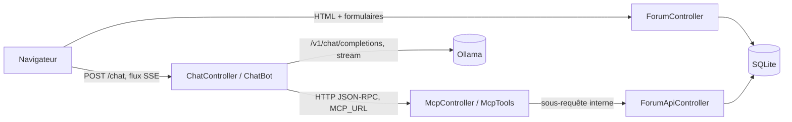
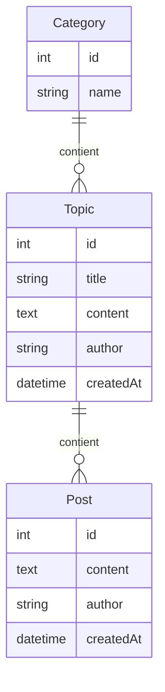
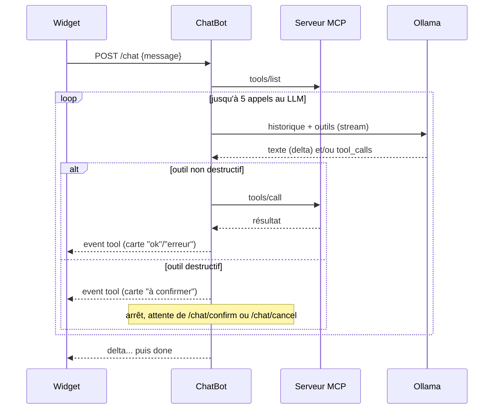

# Documentation technique

Forum de démonstration (catégories, sujets, messages) servi en HTML et en API REST, exposé comme serveur MCP et piloté par un assistant conversationnel branché sur un LLM local (Ollama).

## Sommaire

1. [Stack](#stack)
2. [Architecture](#architecture)
3. [Installation et commandes](#installation-et-commandes)
4. [Configuration](#configuration)
5. [Modèle de données](#modèle-de-données)
6. [Interface web](#interface-web)
7. [API REST](#api-rest)
8. [Serveur MCP](#serveur-mcp)
9. [Assistant (chatbot)](#assistant-chatbot)
10. [Logs et traçabilité](#logs-et-traçabilité)
11. [Tests](#tests)
12. [Limites connues](#limites-connues)

## Stack

| Couche | Choix |
|---|---|
| Langage | PHP 8.4 |
| Framework | Symfony 8.1 |
| Persistance | Doctrine ORM 3, SQLite (`var/data_<env>.db`), migrations Doctrine |
| Front | Twig, AssetMapper (pas de build Node), Stimulus, Turbo |
| Documentation API | NelmioApiDocBundle (OpenAPI, Swagger UI) |
| Serveur HTTP | FrankenPHP (Caddy), image `dunglas/frankenphp:1-php8.4-bookworm` |
| LLM | Ollama `0.40.6`, modèle `qwen3:4b-instruct`, CPU uniquement |
| Tests | PHPUnit 13, `WebTestCase`, `MockHttpClient` |

## Architecture

```
src/
├── Chat/ChatBot.php                 Conversation avec le LLM, boucle d'appels d'outils, confirmation
├── Controller/
│   ├── ForumController.php          Pages HTML du forum
│   ├── Api/ForumApiController.php   API REST JSON (documentée OpenAPI)
│   ├── McpController.php            Serveur MCP (JSON-RPC sur HTTP)
│   └── ChatController.php           Endpoints du widget (flux SSE)
├── Mcp/
│   ├── ApiToolRegistry.php          Transforme chaque opération OpenAPI en outil MCP
│   ├── McpTools.php                 Outils servis : API générée + suppressions par nom
│   └── McpClient.php                Client MCP minimal utilisé par le ChatBot
├── Dto/                             Payloads validés (#[MapRequestPayload])
├── Entity/                          Category, Topic, Post
├── Log/TraceId.php                  Identifiant de trace commun aux logs
└── DataFixtures/AppFixtures.php     Jeu de données de démonstration
```

Les trois façons d'agir sur le forum s'empilent : l'assistant passe par le serveur MCP, qui passe par l'API REST. Aucune logique métier n'est dupliquée.



Points notables :

- Le ChatBot appelle le serveur MCP **en HTTP**, sur sa propre application (`MCP_URL=http://localhost:8080`, depuis le conteneur). C'est volontaire : le chatbot se comporte comme n'importe quel client MCP. Cela suppose que FrankenPHP dispose de plusieurs threads PHP (c'est le cas par défaut), sinon la requête `/chat` attendrait indéfiniment la requête `/mcp`.
- Le serveur MCP n'appelle pas Doctrine : chaque outil exécute l'opération API correspondante en **sous-requête Symfony** (`HttpKernelInterface::SUB_REQUEST`), donc sans aller-retour réseau, avec la même validation et les mêmes codes d'erreur que l'API.

## Installation et commandes

Prérequis : Docker avec Compose, `make`.

```bash
make install   # build, up, composer install, migrations, fixtures, téléchargement du modèle
```

L'application est servie sur http://localhost:8090. Ollama est exposé sur le port `11434`.

| Cible | Effet |
|---|---|
| `make build` | Construit l'image `app` |
| `make up` / `make stop` / `make down` | Démarre / arrête / supprime les conteneurs |
| `make terminal` | Shell `bash` dans le conteneur `app` (utilisateur `www-data`) |
| `make vendor` | `composer install` (exécuté avec l'UID de l'hôte : `vendor/` appartient au développeur) |
| `make db-update` | Exécute les migrations en attente |
| `make fixtures` | Recharge les données de démo (**vide la base**) |
| `make llm-pull` | Télécharge le modèle Ollama dans le volume `ollama` (une seule fois) |

Le code n'est pas copié dans l'image : il est monté depuis l'hôte (`.:/app`). OPcache revalide les fichiers à chaque requête (`docker/app/php.dev.ini`). L'image est donc **une image de développement uniquement**.

Commandes Symfony dans le conteneur :

```bash
docker compose exec --user=www-data app php bin/console debug:router
```

## Configuration

Variables d'environnement (`.env`, à surcharger dans `.env.local`) :

| Variable | Défaut | Rôle |
|---|---|---|
| `DATABASE_URL` | `sqlite:///%kernel.project_dir%/var/data_%kernel.environment%.db` | Base de données |
| `DEFAULT_URI` | `http://localhost:8090` | URL de base pour les URL générées hors requête HTTP |
| `OLLAMA_URL` | `http://ollama:11434` | Ollama, vu depuis le conteneur `app` |
| `OLLAMA_MODEL` | `qwen3:4b-instruct` | Modèle utilisé. Doit supporter le *tool calling* et être téléchargé (`make llm-pull OLLAMA_MODEL=...`). À garder synchronisé avec la variable du `Makefile` |
| `MCP_URL` | `http://localhost:8080` | Serveur MCP joint par le chatbot, vu depuis le conteneur |

Autres réglages :

- `config/services.yaml` : paramètre `app.chat.system_prompt`, le prompt système de l'assistant.
- `config/packages/framework.yaml` : clients HTTP `ollama.client` (timeout 120 s, le modèle tourne sur CPU) et `mcp.client`. Ils sont injectés par nom d'argument (`$ollamaClient`, `$mcpClient`).
- `compose.yaml` : `OLLAMA_KEEP_ALIVE=1h` garde le modèle en mémoire (le rechargement coûte environ 7 s sur le premier message après une pause).

## Modèle de données



| Entité | Champ | Contraintes |
|---|---|---|
| `Category` | `name` | 100 max (colonne) ; obligatoire et 100 max via `CategoryInput` à la création par l'API |
| `Topic` | `title` | obligatoire, 150 max |
| | `content` | obligatoire, 10 000 max |
| | `author` | obligatoire, 50 max |
| `Post` | `content` | obligatoire, 10 000 max |
| | `author` | obligatoire, 50 max |

- `createdAt` est fixé à la construction (paramètre optionnel, utilisé par les fixtures).
- Suppression en cascade côté Doctrine (`cascade: ['remove']`) : supprimer une catégorie supprime ses sujets et leurs messages. Il n'y a pas de `ON DELETE CASCADE` en base : toute suppression doit passer par l'ORM.
- Tris : sujets d'une catégorie du plus récent au plus ancien, messages d'un sujet du plus ancien au plus récent (`#[ORM\OrderBy]`).
- Groupes de sérialisation : `category`, `topic`, `topic:posts`, `post`.

Les fixtures (`AppFixtures`) génèrent 6 catégories, 10 sujets par catégorie, 0 à 15 réponses par sujet, avec 30 auteurs. Faker est initialisé avec une graine fixe (`2026`) : tous les postes obtiennent les mêmes données.

## Interface web

| Route | Nom | Rôle |
|---|---|---|
| `GET /` | `forum_index` | Liste des catégories (nom, nombre de sujets, date du dernier sujet) |
| `GET\|POST /category/{id}` | `forum_category` | Sujets de la catégorie et formulaire « Nouveau sujet » |
| `GET\|POST /topic/{id}` | `forum_topic` | Sujet, réponses et formulaire « Répondre » |

Les formulaires sont construits inline avec `createFormBuilder()` sur l'entité ; la validation repose sur les contraintes `#[Assert]` des entités. Après succès : redirection vers le sujet (pattern PRG).

Templates : `templates/base.html.twig` (inclut le widget de chat sur toutes les pages), `templates/forum/*.html.twig`. Le CSS (`assets/styles/app.css`) gère un thème clair et sombre via `prefers-color-scheme`.

## API REST

Toutes les routes sont préfixées par `/api`, en JSON, `{id}` limité aux chiffres. Les erreurs (404, 422) sont rendues en JSON (`format: 'json'`). Les payloads sont désérialisés et validés via `#[MapRequestPayload]` et les DTO de `src/Dto`.

| Méthode | Chemin | operationId (= nom d'outil MCP) | Réponse |
|---|---|---|---|
| GET | `/api/categories` | `get_api_category_list` | 200, catégories triées par nom |
| POST | `/api/categories` | `post_api_category_create` | 201 / 422 |
| GET | `/api/categories/{id}/topics` | `get_api_topic_list` | 200 / 404 |
| POST | `/api/categories/{id}/topics` | `post_api_topic_create` | 201 / 404 / 422 |
| GET | `/api/topics/{id}` | `get_api_topic_show` | 200 (sujet + messages) / 404 |
| POST | `/api/topics/{id}/posts` | `post_api_post_create` | 201 / 404 / 422 |
| DELETE | `/api/categories/{id}` | `delete_api_category_delete` | 204 / 404 |
| DELETE | `/api/topics/{id}` | `delete_api_topic_delete` | 204 / 404 |
| DELETE | `/api/posts/{id}` | `delete_api_post_delete` | 204 / 404 |

Documentation interactive : http://localhost:8090/api/doc (Swagger UI), spécification brute : `/api/doc.json`.

Exemple :

```bash
curl -X POST http://localhost:8090/api/categories/1/topics \
  -H 'Content-Type: application/json' \
  -d '{"title": "Bonjour", "content": "Premier sujet", "author": "alice"}'
```

## Serveur MCP

`POST /mcp`, transport *Streamable HTTP* en mode réponse JSON uniquement (pas de flux SSE, pas de session).

Méthodes JSON-RPC prises en charge :

| Méthode | Réponse |
|---|---|
| `initialize` | Version de protocole demandée si connue (`2025-11-25`, `2025-06-18`, `2025-03-26`), sinon la plus récente ; capacité `tools` |
| `ping` | `{}` |
| `tools/list` | Définitions des outils |
| `tools/call` | `CallToolResult` |
| autre | Erreur `-32601` |

Une requête sans `id` est une notification : réponse `202` sans corps. Un outil inconnu donne l'erreur `-32602`. Un en-tête `Origin` dont l'hôte diffère de celui de la requête est refusé en `403` (protection contre le DNS rebinding exigée par la spécification).

### Génération des outils

`ApiToolRegistry` lit la spécification OpenAPI produite par Nelmio et crée **un outil par opération** :

- nom : `operationId` ; description : `summary` de l'opération ;
- `inputSchema` : paramètres de chemin et de requête, plus les propriétés du corps JSON, aplatis dans un seul objet (les `$ref` sont résolus). Une collision de nom entre paramètre et propriété lève une `LogicException` ;
- annotations : `readOnlyHint` vrai pour les `GET`, `destructiveHint` faux par défaut, surchargeable dans l'attribut OpenAPI :
  ```php
  #[OA\Delete(summary: '...', x: ['mcp-annotations' => ['destructiveHint' => true]])]
  ```
- l'appel reconstruit la requête HTTP et l'exécute en sous-requête. Une erreur API (404, 422...) est renvoyée au modèle comme résultat d'outil avec `isError: true`, pour qu'il puisse corriger son appel.

Conséquence : **ajouter une route dans `ForumApiController` avec ses attributs OpenAPI suffit à l'exposer comme outil MCP**, sans autre code.

### Suppressions par nom

Un modèle ne connaît pas les identifiants sans appel supplémentaire. `McpTools` masque donc les outils `delete_api_*` et les remplace par :

| Outil | Arguments | Recherche |
|---|---|---|
| `delete_category` | `name` | Parmi toutes les catégories |
| `delete_topic` | `title` | Parmi tous les sujets de toutes les catégories |
| `delete_post` | `topic`, `author` et/ou `excerpt` | Parmi les messages du sujet trouvé |

La correspondance est insensible à la casse : correspondance exacte d'abord, sinon sous-chaîne. Il faut exactement un résultat ; sinon l'outil renvoie une erreur listant jusqu'à 10 candidats, que le modèle peut relayer à l'utilisateur. Ces outils passent eux aussi par l'API (sous-requêtes), jamais par Doctrine.

## Assistant (chatbot)

Widget présent sur toutes les pages (`templates/chat/_widget.html.twig`, contrôleur Stimulus `assets/controllers/chat_controller.js`), conservé entre les navigations Turbo (`data-turbo-permanent`).

### Endpoints

| Route | Rôle |
|---|---|
| `POST /chat` | Corps `{"message": "..."}` (obligatoire, 2 000 caractères max, sinon 422). Réponse en flux SSE |
| `POST /chat/confirm` | Exécute l'action en attente de confirmation. Flux SSE. 409 si rien n'attend |
| `POST /chat/cancel` | Annule l'action en attente, le LLM en prend acte. Flux SSE. 409 si rien n'attend |
| `POST /chat/reset` | Efface la conversation. 204 |

Événements SSE émis :

| Événement | Données |
|---|---|
| `tool` | Carte HTML d'un appel d'outil, rendue avec le même partial que l'historique (`chat/_transcript.html.twig`) |
| `delta` | Morceau de texte de la réponse, au fil de l'écriture du modèle |
| `done` | Fin normale |
| `error` | Échec (le statut HTTP 200 est déjà parti quand le LLM répond, l'erreur ne peut donc pas être un code HTTP) |

Côté client, le flux est lu avec `fetch` (un `EventSource` ne peut pas faire de `POST`). Un flux sans `done` est traité comme une erreur. Une seule requête à la fois : le formulaire est désactivé pendant le traitement.

### Déroulement d'un message



- L'API utilisée est celle d'OpenAI (Chat Completions), servie par Ollama sur `/v1/chat/completions`, en `stream: true`. Les fragments de `tool_calls` sont réassemblés par index.
- `MAX_ROUNDS = 5` appels au LLM par message ; le dernier est fait **sans outils** pour forcer une réponse textuelle.
- `set_time_limit(600)` : jusqu'à 5 appels de 120 s chacun.

### Confirmation des actions destructives

Un outil est considéré destructif s'il n'est pas `readOnlyHint` et que `destructiveHint` n'est pas `false` (valeurs par défaut de MCP). En pratique : les trois `delete_*`. Les créations s'exécutent sans confirmation.

- Le premier appel destructif d'une réponse passe en statut `pending` : l'appel est stocké tel quel dans l'historique (`tool_call`), le résultat transmis au LLM est « En attente de confirmation par l'utilisateur. » et la boucle s'arrête.
- Les appels destructifs suivants de la même réponse passent en `skipped` (une seule action en attente à la fois).
- **Confirmer** exécute l'appel stocké, sans redemander au LLM : un petit modèle pourrait sinon prétendre l'avoir fait sans appeler l'outil. Le LLM reprend ensuite la main.
- **Annuler** remplace le résultat par une consigne de ne pas refaire l'action, puis le LLM répond **sans outils**. L'annulation est enregistrée avant l'appel au LLM : elle tient même s'il échoue.
- Envoyer un nouveau message alors qu'une action attend l'annule.

Statuts affichés sur les cartes : `ok`, `erreur`, `à confirmer`, `non exécuté`, `annulé`.

### Stockage de la conversation

- L'identifiant de conversation est stocké en session (`chat_conversation`) ; la conversation elle-même (messages, appels d'outils, métadonnées d'affichage) est stockée dans le cache applicatif (`chat_history_<id>`, TTL 24 h). Raison : la réponse est diffusée en flux, la session est déjà sauvegardée quand la conversation se termine.
- L'historique complet est renvoyé au LLM à chaque message, précédé du prompt système. Les clés internes `display` et `tool_call` sont retirées avant l'envoi.
- Un appel au LLM en échec n'est pas enregistré : l'historique ne garde pas de message utilisateur sans réponse.
- La fonction Twig `chat_transcript()` reconstruit l'affichage à partir de l'historique au rechargement d'une page ; elle ne démarre pas de session si aucune n'existe.

## Logs et traçabilité

Canaux Monolog dédiés : `chat` (ChatBot) et `mcp` (sous-requêtes API exécutées par les outils). En `dev`, ils sont écrits, avec les erreurs du canal `request`, dans `var/log/chat.log`, une ligne par étape :

```bash
tail -f var/log/chat.log
```

`App\Log\TraceId` ajoute `extra.trace` à chaque enregistrement de log. L'identifiant est généré une fois par requête principale et transmis par le `McpClient` dans l'en-tête `X-Trace-Id` : la requête `/chat` et les requêtes `/mcp` qu'elle déclenche partagent la même trace. Un identifiant entrant non conforme (`[\w-]{1,64}`) est ignoré.

## Tests

```bash
docker compose exec --user=www-data app php bin/phpunit
```

| Fichier | Couverture |
|---|---|
| `tests/Controller/Api/ForumApiControllerTest.php` | Création et lecture, suppression en cascade, 404, 422, Swagger |
| `tests/Controller/McpControllerTest.php` | Handshake, liste des outils, annotations, appels, suppressions par nom, erreurs, contrôle de l'`Origin` |
| `tests/Controller/ChatControllerTest.php` | Historique, flux SSE, boucle d'outils, confirmation et annulation, échec du LLM, arguments invalides |
| `tests/Log/TraceIdTest.php` | Génération et propagation de l'identifiant de trace |

Le LLM et le serveur MCP sont simulés avec `MockHttpClient` dans `ChatControllerTest` : les tests ne nécessitent ni Ollama ni réseau.

## Limites connues

- **Aucune authentification** : le forum, l'API, le serveur MCP et l'assistant sont ouverts. Les pseudos sont saisis librement. Ne pas exposer l'application en dehors d'un poste local.
- Pas de modification de contenu, ni de suppression depuis l'interface web (suppression via l'API ou l'assistant uniquement), pas de création de catégorie depuis l'interface web (API ou assistant).
- Pas de pagination : toutes les catégories, tous les sujets et tous les messages sont chargés.
- `McpTools::findTopic()` fait un `GET` par catégorie à chaque recherche de sujet. À remplacer par une route de recherche dans l'API si le forum grossit.
- `McpClient` ne fait ni handshake `initialize`, ni gestion de session, ni SSE : suffisant pour notre serveur, insuffisant pour un serveur MCP tiers.
- `ApiToolRegistry::resolve()` inline les `$ref` récursivement : un schéma auto-référent bouclerait indéfiniment.
- Image Docker de développement uniquement (code monté, OPcache en revalidation, HTTP sans TLS).
- Le modèle tourne sur CPU : une réponse peut prendre plusieurs dizaines de secondes.
